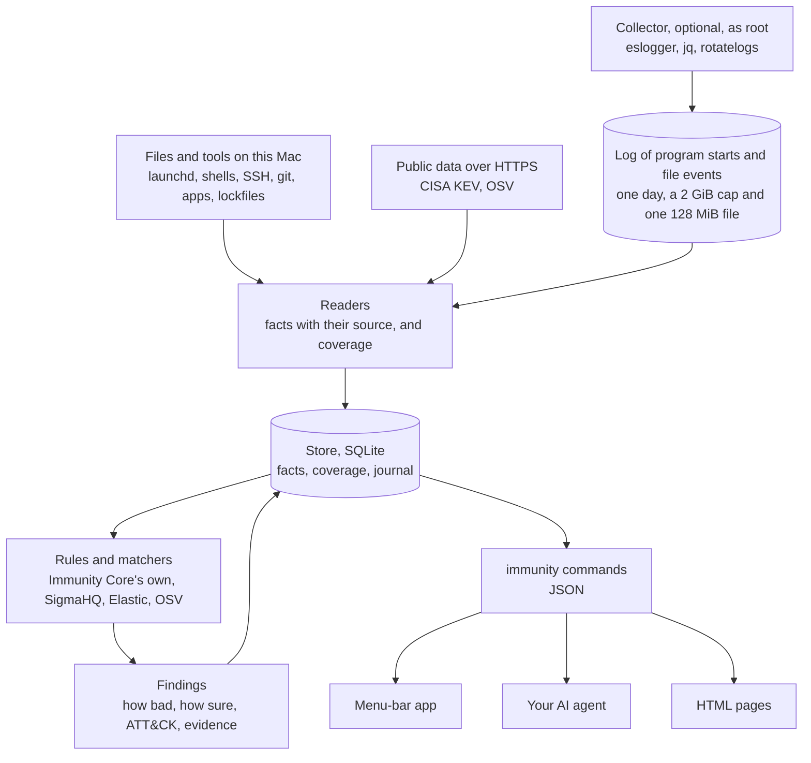

# How Immunity Core works

Immunity Core is one Rust program, `immunity`, with SQLite compiled in, and an optional collector made of programs that macOS ships. A menu-bar app that shows what the program returns is built outside this repository. This page describes how the parts fit: what Immunity Core keeps, how a reading becomes a finding, and what a finding, a gap in coverage and an answer mean. [reference.md](reference.md) lists every reader, [threats.md](threats.md) covers vulnerabilities and indicators, and [event-level.md](event-level.md) covers the collector.

## The parts

```
Readers → Store → Rules and matchers → Findings → Store → Commands → App, agent, pages
```

- Readers look at one kind of source each: launch agents, shell profiles, lockfiles, installed applications, the SSH configuration, the collector's log, and so on. A reader writes statements about what it saw and a record of what it looked through.
- The store is one SQLite database in write-ahead mode, by default `~/Library/Application Support/ai.nuanu.immunity.core/store.db` with its `store.db-wal` and `store.db-shm`. Raw input the readers keep, the downloaded vulnerability data and the HTML pages live in the same folder.
- Rules and matchers read the store and write findings into it. Immunity Core's own rules are plain Rust code, and over the event log they may also be Sigma files in `rules/immunity/` where no published rule exists. Published rules are evaluated by the `sigma-rust` crate: SigmaHQ's rules for macOS, shipped unchanged, and Elastic's detection rules and behaviour rules for macOS that translate into Sigma exactly over what the collector records. Matchers compare what the readers found with vulnerability data and indicator lists.
- Commands read the store and answer with one message of the contract: protobuf with `--proto`, JSON with `--json`, and text for a person rendered from the same message without either. Only `immunity servers`, `immunity view` and `immunity watch` print something else. The app, the user's AI agent and the HTML pages all read the same commands.

The store is the one seam between the parts. What a reader saw, what a rule found and what a person answered are all rows in it, and the commands, the app and the pages read nothing else. No other layer or interface sits between the parts. That keeps any one of them replaceable: a collector, for example, can be swapped for another that writes the same facts.

The same flow, with what feeds each part:



## When things run

A full check, `immunity run`, runs every reader once and then every rule. A run given a `--checkouts-root` other than the home folder looks for projects only there, so it is not a full check: the status stays as old as the latest full check, and what was lost since that check stays counted. The [background service](core-service.md) runs `immunity watch --background`, which starts a full check at startup and every hour. The watcher does the faster work:

- it reads the places where persistence lives about a second after FSEvents reports a change there. First it reads only the readings whose places the change is in, each whole: one kind of place on this Mac, the hooks of one checkout, or one way a file runs code by itself in every checkout. It reads every place at its start, whatever an earlier watcher left, after a reading that failed, when it finds new places to watch or a new way into one, when FSEvents says it dropped or coalesced events, and when a change is at a path in no watched place. A path is matched to a place by its spelling, and a link spelled in another case or Unicode form, or a hard link, gets past that. So after any reading of some places, and when a watched path now leads somewhere else, the watcher reads every place at its next look at what to watch, once a minute. While nothing else holds the store, the place a change names is read within seconds and every other place within about a minute. What one watcher still owed when it stopped, and whatever changed while none ran, is read by the next one at its start. It subscribes before that reading begins, so a change made meanwhile is either in the reading or brings an event. On a Mac where nothing changed that reading records no change and opens nothing;
- it samples the user's programs and their internet connections every 30 seconds (`--sample-every`);
- it reads the collector's log every 10 seconds (`--events-every`), when the collector is installed, and within about a second of a line that a rule raising a finding matches, once for each such rule between two of those readings. It reads one log file at a time and commits each, and reads the next file at once while unread log remains ([the event level](event-level.md#how-immunity-core-reads-it)).

The watcher prints one JSON line per event. Only one watcher may hold a store, and a full check waits up to a minute for a watcher's reading or a command that holds the store; one that still cannot take it stops with exit code 4 and the outcome `run_lock_held`, and keeps nothing a reader read; the background service tries a check of its own again within five minutes. The optional app reads the store through the commands. The core runs when the app is closed.

## Levels of access

What Immunity Core can see depends on the rights it runs with.

| | Without administrator rights | Apple's `eslogger` as administrator | A signed app with Apple's Endpoint Security entitlement |
|---|---|---|---|
| Status | Built, the default | Built, optional (`scripts/event-level/install`) | Not built |
| Collects | State: files, installed software, lockfiles, configuration; file-system events in watched places; samples of the user's processes and connections | Also every program start with its arguments, and every file created or renamed with the program that did it, each process named by its pid, pid version and start time | Also every connection with its host name |
| Detects | Immunity Core's own rules over state, exact matches of indicators and vulnerabilities | Also SigmaHQ's published rules for macOS and Elastic's translated into Sigma | All published rules for macOS |
| Cannot see | The moment a program starts, its command line, who wrote a file | Connections. Apple does not promise `eslogger`'s output as an interface | |

## Entities

An entity is something the user has. Its id is built only from its type and a natural key, so two runs and two readers name the same thing the same way. The types are a closed list kept as rows in the store:

| Type | Natural key | Example id |
|---|---|---|
| `machine` | the name the Mac reports for itself; for a server, the name the user's tools use for it | `machine:<name>` |
| `container` | machine and container name | `container:machine:<name>/<name>` |
| `checkout` | machine and the path of a local repository, from the home folder when it is inside it, otherwise the full path | `checkout:machine:<name>/<path>`, `checkout:machine:<name>//<full path>` |
| `component` | where it is, the ecosystem and the name | `component:machine:<name>/brew/git`, `component:<checkout id>/npm/<name>` |
| `file` | machine and path of a file, or a folder read as one thing | `file:machine:<name>/.zshrc`, `file:machine:<name>//etc/zshrc` |

`repository`, `service`, `account`, `domain`, `key` and `party` are reserved and not used yet.

Ecosystem names follow the vulnerability databases, so matching needs no translation table. Where the databases have no name, Immunity Core's are `brew` for a Homebrew formula, `brew-cask` for a cask and `macos-app` for an application bundle (named by its bundle identifier). A lockfile entry is named by the package it really is, not by an alias it was installed under. Only an entry from the ecosystem's public registry has a bare name; any other carries its source in brackets, such as `(git)`. One from git, a path or another registry is never compared with the registry's package of the same name. One whose lockfile does not record the index it comes from, `(unrecorded index)`, is compared under its plain name, and for a record that does not hold its release the answer is "don't know".

## Facts and their basis

A reader never writes a fact directly. It writes an assertion: one statement from one source.

| Field | Meaning |
|---|---|
| `subject` | an entity id |
| `predicate` | one of a closed list, see [reference.md](reference.md#vocabulary) |
| `object` | an entity id or a literal |
| `reader` | the reader that wrote it |
| `source_ref` | where exactly it was read: a file and line, or a command and section |
| `basis` | how the source knows it |
| `scope`, `kind` | the reading it belongs to, the same pair as in coverage |
| `observed_at` | when the source was first read with this statement, UTC |
| `run_id` | the run that first wrote it |

A fact is the group of assertions with the same subject, predicate and object. Nobody confirms a fact by hand: its assertions show what it rests on.

The basis has three kinds, strongest first, and a reader's kind is fixed in its code:

| Basis | The source is | Example |
|---|---|---|
| `observed` | the thing itself | an installed application, a server's package list |
| `declared` | a description that tooling enforces | a lockfile, the SSH configuration |
| `mentioned` | text | an agent's session, a README |

Text can be written by an attacker. A fact that rests only on `mentioned` assertions is weak and never supports "does not affect me". No reader writes `mentioned` assertions today; the kind exists so that one that reads text cannot pass for a stronger one.

## Coverage

Coverage is a statement about a reading, not about the world. Every reader writes it on every run.

| Field | Meaning |
|---|---|
| `reader`, `run_id`, `observed_at` | as for an assertion |
| `scope` | the entity that was read: a machine, a container, a checkout |
| `kind` | what was looked for there, from a closed list. A kind names exactly what was read, so a reading never claims more than it covered |
| `completeness` | `full`, `partial` or `none` |
| `reason` | required for `partial` and `none`. On `full` it is an optional note |

Beside each reading the store keeps a row for each thing it did not read (`coverage_unread`): the unit by its path and part, or no unit for what is not one, such as a tool that failed or the folder a run was limited to; its cause; how it was not read, a word of a seeded vocabulary (`unread_how`); the system's error number, when it gave one; and what the source said, with secrets cut. A full reading has no row, any other has at least one, and its cause is the worst cause of its rows. A reader that names no unit gets one row with no unit, with the reading's cause. What the core decides about what a reading did not read is decided from these rows and never from its reason, which is prose for a person in which a name from the Mac may hold a comma, a semicolon or the words of an error: a failure the system refused for want of permission (EPERM or EACCES), a folder macOS asks permission for, a place a tool was looked for, a walk limited to the folder given, and which ecosystems a lockfile reading leaves in part unknown.

A reader first finds out whether its source exists on this Mac. A source that is not there, such as Homebrew on a Mac without it, is not applicable: a full reading that found nothing, with that note, and not a failure. A source that is there and cannot be read is a failed reading, `none` with its reason. A source that is there and says it is not connected, such as Tailscale switched off or waiting for a login, gives nothing for now: `none` with the cause `not_given`, so what was known from it stays, and it is not a failure. Its documented states are a table, each with fixed words; a state in which it cannot be read this time, or one this version does not know, is a failed reading. A source Immunity Core has no reader for, such as a `requirements.txt` beside the lockfiles it does read, or software installed with MacPorts or Nix, is named as having no reader. These four stay apart all the way to the app.

Two rules are invariants, each with its test:

- "Does not affect me, known for certain" needs `full` coverage of that scope and kind, and fresh.
- A missing reading is not evidence of absence. A reader that could not read a scope retracts nothing in it.

Freshness is judged per reader, scope and kind, by the time of its latest reading. A watcher's reading of one kind of place makes only that kind fresher.

The answers hold for a store that one Mac writes, a clock that goes forward, log files that only the collector writes, a store folder that only the core writes, and developer tools as the system installed them. In any other state an answer may be wrong, and Immunity Core does not always detect that it is.

The store keeps every reading of the runs the changes page lists (the last 20 runs of any kind, a watcher's readings and samples among them), of the latest finished run, which `immunity status` reports on, and of everything written after the oldest of these. Older readings are folded at the end of every full run. Of a run of unchanged readings of one reader, scope and kind, with the same completeness, reason and cause, only the first and the last are kept: the first says since when, the last until when. A failure or any other difference ends the run, and so does a reading dated before the one before it, as when a clock was set back; the next reading starts a new run. The latest reading of each reader, scope and kind is never taken out, so every answer about coverage and freshness is the same after a fold as before it. Whenever a quarter of the file or more is free pages, whichever run freed them, the space goes back to the file; fewer free pages are kept for the rows written next. The fold is housekeeping after the run has committed: when it or the giving back cannot finish, as while another process reads the store, the run still succeeds and the next run does it.

`immunity status` turns coverage into what a person reads: one item per cause in `not_covered`, never one per machine or file, each saying who can act on it. `you` means the user can, for a server not swept, a file of their own whose permissions keep Immunity Core out, or a network that blocks a download. `nothing` means it is a limit of this version, a file of another account closed to it, or something tried again at every check. A gap in coverage is never counted as something that needs a look. Agents also get the detail in `coverage`, `cannot_judge` and `no_reader_for`.

The text of `immunity status` and `immunity run` tells three kinds of gap apart. A limit is something this version does not read here, such as a kind of lockfile with no reader, a folder macOS protects or an event level that is not installed; the text leaves it out, and `--coverage` lists it under "Limits of this version here". A fault is a shortfall Immunity Core has reason to expect met on this Mac now, and each item of `not_covered` says which it is in `fault`. The reason is either Immunity Core's own work or something given here before. Its own work is a full check that finishes, a watcher that runs and reads, a collector that, once installed, records without loss and records what this version reads, and downloaded data that is current. A download that failed is therefore a fault only once the data it would have refreshed is not current by its feed's limit, the moment answers resting on it turn to "don't know", or when nothing of it was ever downloaded; while the data read before is current it is said nowhere in the text, and the status still gives its outcome. Every reading that failed is a fault, and so is a reading not full that kept no cause. A file of another account that is closed to this one (EACCES, never EPERM) and was never read here under any of its names (as named, made real, spelled otherwise or reached through a stored link) is not given by its source, so it is no failure. The same holds for a file behind a folder of another account that this account cannot search, while nothing inside that folder was ever read here either, as long as the lookup that met the folder passed no folder or link of this account's own on the way: what lies in those can be renamed or pointed anywhere. One function decides this, and no reader picks that cause by itself. The file integrity tools we know of report every file they cannot open the same way; weighing it by who owns it and whether this store ever read it is Immunity Core's own. Given here before is decided from the store's tables, never from the words of a reading. The baseline marks each unit of the watched places, the startup programs and the checkout walk that is there and not read now, whatever the cause: a file closed, turned away by the guard of protected folders, past the size read or in a project not looked into; a folder the walk could not list; what Git's configuration says of a checkout's hooks; and what a startup item runs, the item standing for it. A marked unit that an earlier run read in full, by the same test that makes losing sight of it a finding, is named in the cause `read-before-not-read-now`; a file read whole covers its parts, a part read counts for its file, and what was read inside a folder counts for the folder. A unit belongs to the deepest project that holds it. The content of a watched file is read per file, and the same cause names it when its latest reading is not full and an earlier one was. One thing is one line: a unit is left out of that cause while a failed reading of its reader and kind is in the same answer, since that reading is a fault already and names why, and the content is left out while its own reading failed. So the cause adds a unit only beside a full reading of its kind, as after a check that did not look at it again, and never takes away the last fault of a kind. A mark ends when its unit is read again, something inside it is read, it or a folder holding it is found absent, or what holds it is gone: its file, or for a project's own kinds the deepest project that held it. A unit never read here is never named. Who can fix it chooses only the words. A file read at one check and closed at the next raises its kind's finding when sight of it is lost, and stays a fault after the person answers that finding. A unit is known by its name, so a file renamed, or reached through a link under a new name, has never been read under that name. Each fault is a line marked `!` while it stands, with the command that ends it at the end of the line. A finding needs a look and is listed by rule under the headline.

## Lifecycle

Assertions live in three layers: draft, live and retracted.

- A run writes into draft.
- At the end of the run, for each scope and kind the reader covered in full, draft is compared with live. New assertions become live. Assertions no longer made move to retracted, with the time.
- Under partial coverage new assertions still become live and nothing is retracted. Under no coverage nothing changes.
- Each difference is an event, `added`, `changed` or `removed`, counted per subject and predicate, so a new version of a component is one `changed` event.
- When a checkout or a container is gone, everything read inside it is retracted with it, as one `removed` event. Whether it is gone is decided once, after the run's last reader: a thing any reading of the run still places is not gone, whatever order the readers came in. A mark of `expected` that ended is judged again after the vulnerability data is matched. The programs startup items run are read after every other kind of watched place, so a file that another kind reads under the same path has that kind as its one reader; one named by its full path inside the home folder is still also the home folder's file of another name, and both are written.
- A kind an earlier version read and this one does not has no reading any more. Once per scope, its facts are closed by a journal entry of their own, `retired`, with the reason, and its reading becomes `none` with no reader. It is never told as removed or gone, and the run says it once, in its text and in its line on the pages. For autorun points the same holds of one thing: a file or key an earlier run read that no row of this version names any more is closed as `retired` by the next reading of every place, and its content goes with the last row that watched it. When that reading is a watcher's, the next run says it, since a watcher's own lines are not where a person is told.
- Freshness is judged by one rule: a time more than five minutes ahead of this Mac's clock has no age, and what has no age is never fresh.
- Retracted assertions are kept. An investigation looks back.
- Whether a thing is still there is read from these layers in one place (`known::presence`) for `immunity project`, `immunity program` and `immunity machine`: gone only when the latest reading of each that held it was full and its latest retraction there, in the order of runs, was not a `retired` one, which a reading writes without looking.

What a reading finds is judged by what earlier readings can show. The unit is the smallest thing one failure can hit: a file, a selected part of a file, or a folder listing. The reader gives the physical path and any selected key separately. A failed part leaves only that part unread; a failed file leaves every part unread. Reading a part or confirming its absence clears its own unread mark and ends the whole-file failure. A sibling's unread mark stays in force until that sibling is read or confirmed absent. Only reading the whole file establishes full coverage.

Something found is one of three things:

- A change, when the store can show it was not there before. Its unit was read by an earlier run, or it is new in a folder listing that an earlier run recorded in full. A checkout is new when an earlier walk listed its parent folder in full and the checkout was not in it; then everything in it is a change. That is how a clone made after the first check is found, hooks included: git copies the hooks of its template folder into every new clone. A change raises the finding of its kind's rule.
- The baseline, silently, only before the store's first full check and only in the first reading of its reader and kind, whether a watcher or that check reads it first, for what no earlier run met, in a folder no earlier run listed. Nobody could have known what was there before. A later reading of the same kind, before the first check too, has an earlier one to compare with, so what it meets first is read for the first time: a watcher reads before the first check, and what is put in a place after its first reading is no part of the baseline. The journal marks each such difference `first reading of its place`.
- Read for the first time: everything else. After the first check, a place can come into reach with no proof that it is new: a run pointed at a folder the walk does not enter, a project first named in an agent's session, a folder that could not be listed before, a place a newer version reads. What it holds becomes its baseline, and it is never silent: one informational finding per check, `watched.first-read`, about that check and raised for it whatever was answered about an earlier one, names each such place and how many things in it run by themselves. The journal marks each difference `read for the first time`, and `place_first_read` for each place.

Both readers of autorun points, the watched places and the ways a file runs code by itself, and the reading of the programs startup items run, record what they read through one type, and the store compares through it (`src/look.rs`). A unit becomes read in full only with proof that its path is not there, or by being read; a unit that could not be read carries its reason; and what was known of a unit is retracted unless a unit left unread hides it, or the reading could not tell every place its units may be and did not read that unit or its file, or list its folder, itself. A folder met and not listed tells nothing of what is inside it, and a unit left unread does not hide what a unit read inside it tells, as a checkout not looked into does not hide what was read in a checkout inside it: the deepest unit decides. So what is gone with what held it, a file, its folder, a project or its `.git`, is retracted with it and told as removed. The same type keeps what a reading did not read that is no unit of it: checkouts it did not look into, the folder Git's configuration names for hooks when it cannot be told, hooks kept where they are not read. The search for projects, the reading of agent sessions, the reading of software changed in place, the reading of lockfiles and the matching of indicators against the texts of projects say what they did not read through the same type: a folder that could not be listed is a unit not read, named with what the system said, and a folder a reader leaves out by design keeps what was known in it and does not make the reading partial. Each unit not read carries how the reason says it, and that gives its cause: one that could not be read failed, while one in a folder macOS asks permission for, one whose name another took first or one over a cap the kind names was not given. The completeness, the cause and the reason follow from these lists alone. A reading that did not read everything is `none` when it read no unit in full, or when what it could not read is all it met that is there, and `partial` otherwise. The watcher tells a place that is not there by the same proof, so a place the reader could not look at, through a link in a loop or a folder whose name is longer than a file's name can be, is a place the watcher could not watch.

Something that is there and cannot be read, or leads into a folder macOS asks permission for, is judged by the same three cases, once while it stays so. Losing sight of a unit an earlier run read is a change, and so is an unreadable thing new to a listing or in a new checkout: each raises the finding of its kind's rule. The reason is in the journal entry `not_read`, and the reading stays in coverage as not read. What was known of the unit is kept, so once it reads again, whatever changed in the meantime is a change.

Something read before is gone only when it is absent. A checkout is absent when its path or its `.git` is not there, or when a folder above it is now something other than a folder or a link. At a link in place of a folder above it, the checkout is looked at through the link, without entering a folder macOS asks permission for. There, it is kept and not walked into: the walk's reading is partial with the cause `not_given` and names it. A link into such a folder keeps it under that folder, with nothing past the link looked up. A link that leads nowhere, or to a folder without its `.git`, is absent; a link loop or a folder that cannot be searched is a checkout that could not be looked at. Where its own path is still there in another form, as a `.git` file where the `.git` folder was or a link where the checkout's folder was, that is losing sight of it: the checkout is kept, and its hooks read before are a finding. A checkout that is there and that the walk did not meet, deeper than it goes or in a hidden folder, is kept as it was and nothing in it is read; a run pointed at its folder reads it. Something gone from a unit read in full is a change, whatever failed elsewhere in the same reading.

A checkout's hooks are judged as if they were in its `.git/hooks`, wherever Git's configuration puts them. The first time a run tells which folder Git runs a checkout's hooks from, the hooks there are its baseline and are told once. After that, a hook in a folder Git now runs hooks from is a change, and so is one in a checkout that is new. A hook that several checkouts run from one folder is new only where no other checkout's reading placed it when the run began with the bytes it has now, and gone only once no checkout's reading places it after the last of them, whichever checkout is read first.

`immunity status`, the journal and the changes page count the same things. A difference marked as a first reading counts as read for the first time, not as added. If the place cannot be read now, what was known about it stays in the store until a successful reading can compare it.

A new worktree of a project the store already holds is compared with that project. Agents make worktrees all day, and each one holds the project's own settings, scripts and tasks byte for byte. When git made a new checkout as a linked worktree of a repository, and the store held another checkout of that repository before this reading, each place new in the worktree is compared with the place at the same path in that other checkout, as the same reading read it. The comparison uses what the reading already compares: the checksum of the file, or of the part that counts. Where the two are equal, the place is recorded like any other, so a later change in it is a finding, and its appearance raises none. The journal records it as `same_as_sibling`, with the checkout it matched. A finding that stands in that checkout stays as it is. Where they differ, or the other checkout has no such place, or it could not be read this time, the finding is raised as usual. Only the worktree's first reading is compared this way; a place that appears in it later is a finding as in any other checkout.

"The same repository" is git's own relation, checked in both directions. The worktree's `.git` file points into `<git folder>/worktrees/<name>`, that folder's `gitdir` points back at the worktree, and its `commondir` names the git folder of a checkout the store holds (or the git folder another such worktree points to). The pointer in the worktree is text anyone who can write there can forge, so it counts only when the repository's folder points back. A separate clone, a copied folder, a folder whose `.git` is a link to the project's git folder, and a checkout with the same name or remote are different repositories, and their places are judged on their own. A submodule's `.git` file points to a folder without `commondir`, so a submodule is never taken for a worktree.

Readers keep their raw input next to the store, copied only when it changed, so that the store can be rebuilt from it. A source that holds secrets keeps only what the reader extracted: the SSH readers keep names and never keys. Homebrew's answer and the vulnerability feeds are kept in reduced form for size. A command that rebuilds the store from raw input is planned. The store carries a format version ([reference.md](reference.md#files-immunity-core-keeps) gives the current one), and a build refuses a store of a format it does not know.

## The journal

The journal is an append-only list of what Immunity Core did and decided. Raw events from the collector do not go there. Its entries include `run_started`, `run_finished` and `report` for a run; `added`, `changed` and `removed` for differences between readings; `finding_raised`, `finding_reopened`, `finding_cleared`, `finding_expected` and `finding_seen`, where a lockfile finding's clearing, and a malicious package that left, keep why and what it was about; `owner_said` and `owner_withdrew` for statements about a machine; `sampled` for what a sample derived, with what it read of the process and the connection a finding is about; `matched` for a published rule's match a finding rests on, with the rule and a count; `same_as_sibling` for a place in a new worktree that raised no finding because it matched its project's; `place_first_read` for a place read for the first time, with how many things in it run by themselves; `not_read` for a unit read before that could not be read, with the reason; `verdict` for a verdict of the response layer; `turned_on`, written by the job's watcher at its first reading after `immunity on`, and `turned_off`, written by `immunity off`, with the time alone; and `threats_first_read`, `threat_added`, `threat_gone` and `advisories_read` for threat data. Each has a sequence number, and a finding refers to the entries it rests on by those numbers (`rests_on`). The words are vocabulary, seeded in `journal_entry`: an entry whose word is not there cannot be written, and a new kind of entry is a new row, not a new format.

A run that died, or that stopped because the store was held past its wait, leaves `run_started` without `run_finished`.

## Findings

A finding is one thing a rule or a matcher found, about one entity, with its evidence. How bad it would be (`severity`) and how sure Immunity Core is (`confidence`) are two separate values, named with OCSF's levels: `informational`, `low`, `medium`, `high`, `critical`. A finding is urgent when its severity is high or critical and its confidence medium or high. Only then does the app send a notification; it decides nothing else.

A finding stays in the store after a later version drops the rule that raised it, for example when a published rule leaves the shipped set. Such a finding is still counted, listed, shown and answered like any other. Its kind is `finding of a rule not in this version`, and its words say that the rule is not in this version, so Immunity Core can say no more than what it kept: where the thing is, when it was seen, its state, its answer and the journal entries it rests on. The store keeps no levels without the rule, so its severity and confidence are absent and it is not urgent. It is ordered as the most severe after the urgent findings.

Each of Immunity Core's own rules is plain code with an id, the ATT&CK technique where one fits, both levels, whether it finds an event or a state, and fixed words for a person: `title`, `meaning` and `advice`. Text from the machine or a feed is never put into those words. It goes in fields whose names end in `_text`, so an agent reading the output can treat it as data. Each rule has two samples in the tests: one it must fire on and one it must stay silent on.

| Rule | Fires on | Technique | Severity, confidence |
|---|---|---|---|
| `watched.autostart` | a launch agent or daemon added, changed or removed | T1543 | medium, low |
| `watched.login-hook` | a login or logout hook in the login window's preferences, the system's or the user's, added, changed or removed | T1037.002 | high, medium |
| `watched.shell-profile` | a zsh or bash startup file added, changed or removed | T1546.004 | medium, low |
| `watched.ssh-access` | `~/.ssh/config`, `authorized_keys`, `rc` or the system's SSH configuration added, changed or removed | | high, low |
| `watched.authentication` | a PAM policy or module, or an authorization plugin, added, changed or removed | T1556 | high, low |
| `watched.git-hook` | a git hook in a checkout added, changed or removed; a file of a git hook manager added or changed: Husky's dispatcher, `husky.sh`, a script it keeps for a hook or its startup file in the home folder, or the configuration of pre-commit, prek or lefthook | | medium, low |
| `watched.startup-target` | the program a launch agent, daemon or login hook starts changed, or can no longer be read, while an item still names it | T1543 | medium, low |
| `watched.first-read` | places read for the first time after the store's first check, one finding per check that names each place | | informational, low |
| `integrity.app-seal` | an application's seal no longer verifies, version unchanged | T1554 | high, medium |
| `integrity.app-signer` | an application signed by someone else, version unchanged | T1554 | high, low |
| `integrity.package-files` | a Homebrew keg or global npm package changed, version unchanged | T1554 | high, medium |
| `integrity.app-code-outside` | code an application keeps under Application Support changed, version unchanged | T1554 | medium, low |
| `autorun.folder-open`, `autorun.editor-open`, `autorun.package-install`, `autorun.agent-start`, `autorun.agent-settings`, `autorun.editor-extension` | a new or changed way a file makes a tool run code by itself, one rule per trigger | from the table of ways, see [reference.md](reference.md#what-runs-by-itself) | from the table |
| `autorun.agent-allowed` | a new or changed `permissions.allow` in a project's `.claude/settings.local.json`, while it is a list of strings. A change of where the file leads is `autorun.agent-start`. The list runs nothing by itself, and Claude Code writes it each time its user chooses not to be asked again | | medium, low |
| `indicator.match` | a file or a connection matches an indicator list | | high, high |
| `processes.detached-inline-code` | an interpreter given code on its command line, left running without a terminal across samples a minute apart | T1059 | high, medium |
| `lockfiles.malicious-package` | a dependency a malicious-package record names | T1195.001 | critical, high |
| `lockfiles.malicious-name-removed` | a dependency whose name the registry replaced with a placeholder | T1195.001 | high, low |
| `lockfiles.exploited-vulnerability` | a dependency with a vulnerability in CISA's catalogue | | critical, medium |
| `sigma:<rule id>`, `elastic:<rule id>`, `immunity:<rule id>` | a Sigma rule marked high or critical, SigmaHQ's, one of Elastic's translated detection rules or one of Immunity Core's own in `rules/immunity/`, matched a program start or a file event. Elastic's behaviour rules (`elastic-behaviour:<rule id>`) state no level and raise no finding | the rule's | the rule's level; medium for a `stable` rule, low otherwise |

A rule of a watched kind, or of a way a file runs code by itself, also fires when a file it read before is there and can no longer be read.

A finding of `integrity.package-files` or `integrity.app-code-outside` says how many files were added, removed and changed since the reading before, and what they were, by structure, as `git status` tells an untracked folder and `diff -r` a folder only in one tree. A folder every file under which, in either list, was added, removed or rewritten is one entry with its number of files, at the outermost such folder below the thing's own; a file is named alone where its folder changed only in part, and a folder of one file is told as that file. A thing that changed whole is told by the folders and files directly in it. The change decides how many entries there are, and only the record's bound of 64 KiB cuts them short: the entries of each kind stop in path order within a third of it, and the line of counts says how many files they leave out. The reading keeps the list its digest is made over, each file's path and change time, and compares it with the list it kept the time before. A file counts as changed when its change time moved; its content is never read. The entries are those of the latest occurrence. When the reading before kept no list, as at the first reading by a build that keeps lists, or that list is gone or damaged, the finding says nothing about files and is raised by the digest as before.

A launch agent or daemon is watched by its property list and a login hook by its value, so a program replaced behind an item that stayed the same would pass unseen. A full check therefore also reads the program each item starts, a watched file of its own kind with its checksum, its signer and the code's identifier, and whether its code verifies. One finding of `watched.startup-target` names every item that runs the program now, and rests on this run's journal entries of what changed, its signer and whether its code verified among them. A change stays out of the findings, and is kept in the journal, when both readings verified, the path leads to the same place, and both name the same identifier and the same publisher Apple vouches for: Apple itself, or a team of the App Store or Developer ID. That is the test macOS applies to tell that two builds are one program. A signer's name alone never passes it, and neither does ad hoc or unsigned code, another certificate, or an App Store or Developer ID signature without a team. A program an item names for the first time is told by that item's own rule. The first reading of programs on a store that already holds a baseline is one `watched.first-read` finding. [reference.md](reference.md#watched-places) has what is read and what is counted as not read.

A rule finds either an event or a state. A finding about an event stays open through quiet runs until it is answered; found again, it is the same finding seen later. A finding about a state (the three lockfile rules) is cleared when a check shows the state is over: the project's checkout is gone, or its lockfiles of that ecosystem were read in full in that check and either no longer hold the package or hold it with every answer for it known on current data. A check that cannot tell, because a lockfile was not read in full, the data is not current or failed to load, or an answer is `unknown`, leaves the finding as it was, with its state and the person's answer. A malicious package's finding (`lockfiles.malicious-package`, `lockfiles.malicious-name-removed`) is never cleared by the core: its code may have run when it was installed, whatever the lockfiles or the data say later. When a check shows its rule no longer finds it, the finding stays and its change becomes `gone`, and only the person's answer ends it. A mark of expected that ends opens it again, since no check finds a package that left. One the person marked seen is cleared as before; if the package comes back after that, it is a new occurrence. Each clearing, and each malicious package no longer found, writes why into its journal entry (`finding_cleared`, or `finding_raised` with the change `gone`), with what the finding was about when it was last found: the answers about its package in its checkout that stood at that check and that its rule fires on, with their records, releases and lockfile lines. The finding rests on that entry, and its evidence is read from it, never from what the lockfiles hold now, so it feeds no answer about them. The reason only describes, and is told from that checkout alone. A published rule raises one finding per rule on a Mac, and further matches add to its count and its evidence.

The states are `open`, `expected`, `seen` and `cleared`.

## Answers

A finding stays open until someone answers it.

- `immunity finding <id> expected --reason <text>` hides it for 30 days, or `--days` from 1 to 3650. If it was found again in the meantime, it opens again when that time ends. Found again is told by the order in which the store wrote the answer and the occurrence, never by their times.
- `immunity finding <id> seen` closes it. The next time it is found is a new finding.
- `immunity finding <id> reopen` takes an answer back.
- `--with <id>` gives the same answer, or takes it back, on the other finding of a pair: the core's finding of a rule and the response layer's finding of that rule about the same thing (see [Verdicts](#verdicts)). The caller names both, both answers are recorded or neither is, and each finding keeps an ordinary answer of its own.
- `--with <id>` given once for each finding answers several findings of one group the same way: findings of `watched.git-hook` on one machine, with one kind of change, about files of one hooks folder, which one tool writes as a whole. `group` in `Findings` says which findings are one group. The caller names every finding, the whole set is checked before anything is written, and every answer is recorded or none is.
- `--journal-seq <n>` ties an answer to what the caller read, as HTTP's `If-Match` does: the answer is refused when a match, a verdict or a new reading joined the finding, or the response layer's finding it shows, after the read whose `journal_seq` it names. A match of the finding's own rule does not refuse `expected`, which already quiets every later match. It is required on `seen` and `expected` given with `--with` or through an agent.

An answer records who gave it: `--via app`, `--via agent`, or the command line when neither is given. Answers in force that were not given in the app are listed in the status as `answered_outside_app`, and the app shows them and can take each back. An AI agent may give an answer only after the person has agreed in the conversation, having been told what the finding is and what the options are, and it passes `--via agent` with the reason they agreed to. So an answer is never silent. Answers are not signed. A program running as the user can rewrite the store directly, so the record covers every answer given through Immunity Core and cannot catch one written around it. Verdicts are not signed either, which is why they never write into the core's findings (see [Verdicts](#verdicts)).

The same holds for a statement about a machine. `immunity owner <name> retired --reason <text>` or `not-mine` sets a server aside: it is no longer offered for the sweep or counted among the servers, and its facts stay as they were. `immunity owner <name> withdraw` takes the statement back. Such a statement never hides a thing seen alive after it: a machine a reader saw later than the statement is listed among the servers again, though still not offered for the sweep. Statements in force that were not given in the app are listed as `statements_outside_app`.

## Verdicts

The response layer, a program outside this repository, reads rule matches and findings, looks into them and gives a verdict with `immunity verdict`: `suspicious`, a person should see it, or `harmless`. Every verdict names the store it was read from and carries the response layer's reason and its reference to its case. A `suspicious` one also carries a severity and a confidence.

A verdict never writes into a finding the core raised: not its state, its occurrences, its evidence, when it was last seen, its levels or whether it is urgent. The core's findings are the same whether verdicts are sent or not, which a test checks over histories of runs, answers and marks ending, with verdicts of every kind sent between them.

A `suspicious` verdict is an event of one rule of Immunity Core's own, `verdict.suspicious`, and raises a finding the way any rule that finds an event does. The finding is about the rule the verdict names (the match's rule, or the rule of the finding it names) and the thing that rule's findings are about on this Mac, so a verdict about a finding and one about a match of the same rule land in the same finding. It has the life of any finding of an event: it stays open as more verdicts come, a mark of expected holds it until the mark ends, and once it is marked seen the next `suspicious` verdict raises its next occurrence. The core never clears it; only the person closes it. Its severity and confidence are the highest that any verdict of its occurrence gave, so they only go up, and it is urgent by the ordinary rule. For a verdict about a match, the finding keeps the event at that line, read again from the log, as a rule's finding keeps events; a match below high stays `below_high` in `immunity matches`, with this finding named beside it. The log keeps about a day, and a decision can take longer: a `suspicious` verdict about a line no longer in the log is recorded and raises its finding all the same, with no event kept, and says so with `event_gone`. The core then has not read the event again or checked that the rule matched it, and the meaning of the finding says that in the core's words. The rule must still be one this build ships and the position one `immunity matches` prints, started at a real time not later than now. A `harmless` verdict about such a line is refused, since there is no match to keep it beside.

A `harmless` verdict is a record: kept and shown beside what it is about. It changes nothing.

The response layer may give a verdict an id it makes, `verdict_id`, so that sending it again after a failure is told from a new decision. The id is a token of printable ASCII, not text. A verdict whose id the store already holds, equal in everything else, is answered with the verdict recorded then, whatever became of its finding or its line since, and nothing is written. The same id on a different message is refused. Verdicts without an id are compared by content: the same message is recorded once while its finding is open.

Beside a finding of the core, the one-line forms (the status, the list, the app) count its verdicts and name the response layer's finding about the same rule and thing; the whole view lists them. A finding the response layer raised shows the reason of the verdict that raised it, and how many more came. The sender's text is data, shown whole, only in `_text` fields and after the core's own words. Each verdict is a journal entry. [reference.md](reference.md#immunity-verdict) has the messages and the codes.

Verdicts are not signed, as answers are not. Anyone who can run `immunity verdict` as the person can send one, and the core cannot tell the response layer from another program doing so. A verdict about a match names a line of the log under the `--system-root` the command is given, as `immunity run` reads the log under its own; whoever can run Immunity Core as the person can do either. That is why a verdict never writes into the core's findings.

## Is this Mac watched and quiet

`immunity status --json` answers this first. What needs a look (`needs_a_look`) is open findings only. Apart from it come:

- this Mac: watched, watched in part when something of its own places read here before is not read now or a reading of them failed and that is a fault, the collector records nothing, or it lost events since the latest finished full check began, or not checked; whether a watcher runs; and each kind of thing watched, with its count and how (`live` within seconds, `sampled`, `events` while the collector records events, or `hourly`);
- what is not covered, as above;
- known vulnerabilities in the projects' packages (`vulnerabilities`), which are never counted in what needs a look;
- the collector's state (`event_level`).

`headline` puts the answer in one word by one rule, which the text of `immunity status` and `immunity run` and the pages of `immunity view` all go by: `unknown`, `not_checked`, `needs_a_look`, `stale`, `in_part` or `calm`. The core computes it from the rest of the message, so it rests on what the message says. Calm needs a fresh check, this Mac watched by a live watcher, and no fault standing; what is left uncovered may be limits. When an answer is fresh and nothing needs a look but a fault kept it from calm, `headline_because` names it by the section of the message that says why: `watcher`, `this_mac`, `not_covered`, `event_level` or `last_run`. A reading that failed and a machine not reached keep it from calm only as a fault in `not_covered`, so the reason `coverage` is not given since 1.33.0. The text says `✓ Nothing needs a look` for both `calm` and `in_part`, and under `in_part` the fault lines say what kept it from calm. Where none of them does, it prints `! Something was not read in full` with `immunity status --coverage`. The text does not take `headline` alone for calm. It prints ✓ only when `needs_a_look` is there and `this_mac.fresh` is true, and otherwise prints the `?` form that fits. The headline follows one order: a finding, then off, then the first check running, then no run of this build that looked, then no finished check, then not fresh, then nothing to look at, then not known. Off never hides a finding or a check that runs: then it is a `!` line. A finding in an answer that is not fresh gets a `!` line with the reason the message gives.

A watcher whose latest reading or sample failed does not count as watching live until the next success, and the failure is served with what failed, when and what it said. A watcher that has waited for the run lock longer than a full check may take, 30 minutes of awake time, makes no reading, as behind a check started by hand that does not end: its lock file says `waiting` with when the wait began, the status serves the failure `read` with since when it waits, and it is live again once it has the lock. The same holds while its latest look at what to watch left a watched place unsubscribed. The watcher's lock file says so while it lasts, and the failure `places` in the store names how many places and the first three with why each was refused. It ends after a look that leaves none, once the watcher has cleared it from the store. A place whose folder cannot be there now, such as one with a file or a link that leads nowhere on the way, is not a failure: it is noticed at the watcher's next look and at the full check, not within seconds. A place that cannot be looked at, through a link in a loop or a folder whose name is longer than a file's name can be, is left unwatched with why, as the reading of it fails.

## The app

The optional app lives in the menu bar. On first launch it asks once for permission to send notifications. It reads the core's status and findings periodically, and gets the details of a finding when asked. The core's first full check can take several minutes.

The panel under the icon answers whether this Mac is OK. Its headline counts the findings that need the person now and the ones to look at. Each finding is a row that starts with the thing itself, a file's path or a program with its arguments, and a click opens its evidence, the response layer's verdicts and the person's answer. An answer given through an agent or on the command line stays in the panel with Take back. What Immunity Core cannot see on this Mac and the person can fix is a group of its own below the findings. Open report opens a page in the browser with everything Immunity Core knows, including known vulnerabilities and rule matches, which the panel leaves out.

The page `immunity view` writes is a report read from the top. Its headline uses the panel's words, and the line under it gives this Mac's name, the state `immunity status` gives under its headline, the last check and when the page was made. Each fault `immunity status` lists follows as a block of its own: its words, what the source said as data, the command that ends it and what the person can do. Which faults there are and what the state is come from the same code as the text, and the glyph is a ring only while a fault stands. The findings follow as a table with tabs for open, answered and all. A row opens to the facts on the left and, on the right, what each voice said: the published rule, the response layer, the person's answer, Immunity Core and what to do. The evidence is what `immunity finding <id>` gives, cut the same way. A finding the response layer raised is shown in the row of the finding it is about only when both are about the same rule and the same thing; any other is a row of its own. The band and the tabs count rows, so such a pair counts once. A table of what is watched gives each kind of place, on this Mac, in the projects and beyond, with how often it is looked at, how many things it holds, its state and when it was last read. A row's state is a fault of the status that names its kind (`watched_kinds`), linked to where the fault is told; otherwise how it was read, "read in full" and "none here" only when the status says its kind was read in full and fresh, "read" when something left it short and "not checked yet" with no reading of it; otherwise a count. Its time is that of its kind's latest reading, and for installed software that of the latest full check. Under the table, while a fault the person cannot fix stands, one line links to the page that names each one. The section on program starts gives three numbers, the rules that matched this week and a row per tactic of the ATT&CK techniques that rules taken in full cover, or that a rule matched this week or raised a finding for, with the square's fill telling which; while program starts are not seen, one line says so instead. Rules watching now are counted as the status counts them. Then come the faults the person can fix, and last before the footer a collapsed section, "What this version does not read here", with one line for each limit, grouped on this Mac, in your projects, beyond this Mac and threat data. Times are in the Mac's time zone, with UTC in the tooltip; the tooltips of the hourly bars give UTC alone. The page and the panel share five colours, each a macOS system colour: red for what needs the person now and for a verdict of suspicious, orange for what is to look at and for a fault, green for a Mac watched in full with nothing to look at and for a verdict of harmless, blue for links, and grey for the rest. Colour is a mark beside the word that says the same: the state's glyph and a tint of the band, a dot at the start of each row of findings and of each state of what is watched, the verdict's word. In the grid a watched technique is tinted green, one a rule matched this week orange, darker with more matches, and one a finding was raised on orange, or red when that finding needs the person now. The hourly bars are blue. The pages list what Immunity Core reads, any reading that failed, and once, at their end, what this version does not read here. Whether a thing not covered is a fault or a limit is the status's `fault`, and the pages decide neither. A fault is in the band, beside the row it leaves short, and in full under "You can fix" or "Could not be read on this Mac". A limit, such as a folder macOS protects or a file with no reader, is only in the last section. How much of a published rule set is evaluated is left to these documents and the commands' machine form.

## Text from a source is data

Files on the Mac, feeds and indicator lists may be written by an attacker, sometimes for an agent to read. Immunity Core takes facts out of them and nothing else:

- every file is opened one way (`src/open.rs`), except what the event level's collector writes, whose reading in `src/events.rs` is not moved yet. It is looked at first, and anything but a regular file is refused without being opened. A place on the Mac is opened by its path made real, with no link left in it, so a link that appears later is not followed. The open never waits, and a file over its size cap is refused before a byte is read. A refusal is never read as the file's content or as nothing there. A folder replaced by a link while its path is being made real is a limit of this version;
- no path, command or URL is ever taken from a feed or an indicator list and used;
- nothing from an indicator list is visited, downloaded or run;
- text from a source is returned only in fields ending in `_text`;
- the HTML pages escape it and run no script except one fixed in the program;
- a secret on a command line is cut out before Immunity Core keeps the command line or prints it, since what Immunity Core prints reaches the person's agent and may reach a model in the cloud. Rules see the command line as it was, in memory. [reference.md](reference.md#secrets-in-what-immunity-core-keeps-and-prints) has what is cut and what is not.

## No model

No model runs in collection, detection or the app, so the same input gives the same findings. An agent may investigate a finding through the commands and explain it to the person, but it cannot change a finding, and an answer it gives is recorded as the agent's. The response layer may use a model; its verdict is recorded beside a finding and can only add to what the person is shown.

## The network and servers

Nothing about the Mac leaves it. Immunity Core takes no command from the network and never connects to the user's servers: it reads a server only from what a sweep script the user runs leaves behind (see [reference.md](reference.md#about-servers)). Its only requests are for public threat data, the same for every user ([threats.md](threats.md#what-is-asked-of-the-network)).

## What comes from the industry and what is Immunity Core's own

Where the industry has a proven name, format or rule set, Immunity Core takes it. Its own design covers only what the industry lacks.

| Part | Taken from |
|---|---|
| Event field names | the Elastic Common Schema, so published rules translate |
| Published rules | SigmaHQ's rules for macOS, unchanged; the Sigma format and its field names |
| A second and a third published rule set | Elastic's detection rules for macOS (`elastic/detection-rules`) and its behaviour rules for macOS (`elastic/protections-artifacts`), translated into Sigma by a program, so one evaluator runs every set; Elastic's field names, the Elastic Common Schema's |
| Techniques | MITRE ATT&CK for Enterprise, release 20.1 |
| Severity and confidence | OCSF's finding fields and level names |
| Vulnerability answers | OpenVEX's statuses: affected, not affected with a justification, under investigation |
| Vulnerability data | OSV's schema, its ecosystem names and its `IsVulnerable` algorithm; CISA KEV |
| Indicators | STIX 2.1 object paths |
| An answer that hides a finding until an end date, with a reason | the industry's practice for alert exceptions |
| An answer refused when what it was read from changed since | HTTP's conditional requests (`If-Match`, RFC 9110) and optimistic concurrency control. Immunity Core's own part is the value: the journal's sequence number at the read, compared with the entries tied to each finding |
| Readers beside a writer | SQLite's write-ahead mode, its design for one writer and many reader processes: a reader reads the last committed state and never waits for a writer, and a writer never waits for a reader. Core Data uses it by default. A writer that closes alone copies the log into the file, as SQLite does by default, and keeps the `-wal`, cut to nothing, and the `-shm` (`SQLITE_FCNTL_PERSIST_WAL` with `journal_size_limit`), as Apple's system SQLite keeps them, since SQLite lets a process that cannot write the folder read only while both are there. Every command opens the store and closes it, so the next open finds no log to read through. Not taken: one process that holds the store and serves the others, since the core listens on no socket |
| How an access to the store ended (`outcome`) | SQLite's result codes, read by the primary and the extended code and never by the words, with `LOCKED` a failure since waiting does not end it; a skip kept apart from a failure, as systemd's `ExecCondition=` keeps it. Immunity Core's own part is the closed list of outcomes in four kinds, skip, refusal, failure of the store and failure of the work, each with one exit code |
| Content judged by its checksum against what is already in force | file integrity monitoring baselines (Tripwire, OSSEC), allow-listing by hash (Santa, AppLocker), "first seen" state in detection rules |
| Which places of persistence are watched | the categories Objective-See's KnockKnock enumerates and MITRE ATT&CK's persistence techniques for macOS. Immunity Core keeps the places current macOS still acts on, that a program running as the user can read without a permission dialog, and that have a normal state to compare with. The rest are named as limits |
| The program a startup item runs | Sysinternals Autoruns and Objective-See's KnockKnock show each item with the file it starts, that file's checksum and its signer; macOS's Background Task Management keeps an item with its executable and its developer's team; osquery's `launchd` table reads `program` and `program_arguments`, the slot launchd starts. Two builds are one program when they name the same identifier and team, as a designated requirement in macOS says. Immunity Core's own part is the rule `watched.startup-target`, a change of the program while an item still names it, quiet only for such an update by its publisher |
| Which files are lockfiles, and which folders hold none of a project's own | OSV-Scanner's list of supported lockfiles, by file name and ecosystem; PEP 405's `pyvenv.cfg` and `venv`'s layout for a Python environment, conda's `conda-meta`, the Cache Directory Tagging Specification's `CACHEDIR.TAG` for a cache, and git's `.git` for another project. Immunity Core's own part is what it does with a lockfile it found and did not open: it names it, and the project is not wholly read |
| Reading a lockfile's format | Each format is read by a parser the project already depends on: `serde_json`, `serde_norway`, `jsonc-parser` and `toml`. Yarn 1's `yarn.lock` is the exception, since no tested implementation of its grammar exists in Rust. It is read by a port of Yarn's own parser (`src/yarn1.rs`), tested on Yarn's own test file. Where Yarn repairs a file, guesses at it or reads it again as YAML, the port refuses it |
| The search for projects staying on one file system | `find -xdev`: a folder on another device than the starting folder is not gone into |
| Opening a file | open(2) on macOS: `O_NOFOLLOW_ANY`, `O_NONBLOCK` and `O_NOCTTY`, and the type checked again on what was opened; a size cap for each read, refused before reading, as osquery's `--read_max` does. Immunity Core's own part is that the path is made real by hand first, so that no folder macOS asks permission for is looked at, and then opened without following any link |
| Collector | Apple's `eslogger`, `jq` and `rotatelogs` |
| Background process supervision | macOS launchd keeps one job running in the user's login session. The core schedules its own checks and uses a process group and a lifetime pipe to stop a check and its tools if the watcher exits. The watcher refreshes its lock while it makes progress so status can detect a stall |
| Who a process is | Apple's audit token, the pid with its version, and the start time `eslogger` gives. The Elastic Common Schema leaves `process.entity_id`, an identifier that survives a reused pid, to each data source to build from what identifies a process; Immunity Core hands over those parts as they are and builds no identifier of its own |
| Reading on from a position the reader keeps | journald's cursors (`journalctl --after-cursor`) and the offsets a log broker's consumer commits |
| A reading that failed told as a fault or a limit | file integrity monitoring baselines (Tripwire, AIDE): the baseline holds what its first scan read, and a file of the baseline that a later check cannot read is reported. Immunity Core's own part is that every shortfall is sorted by one rule, whether there is reason to expect it met on this Mac now, by the core's own work or by what was given here before, and that only a fault keeps the answer from calm |
| A run of unchanged readings kept as its first and its last | monitoring systems such as Nagios and Icinga, which keep for each check the time of its last result and of its last change of state (`last_check`, `last_state_change`) |
| Reading again only where a file-system event is, and everything at start and after lost events | FSEvents' own documentation: its `MustScanSubDirs` and dropped-events flags ask the client to scan again everything it watches; Watchman crawls the whole tree when it starts watching one |
| Trusting a kept position in a file others write | git's index: an unchanged stat stands for unchanged content unless it was taken in the moment of a change ("racily clean"); otherwise the content is hashed and compared |
| The kinds of a verdict | the words security schemas and sandboxes use: the verdict of OCSF's incident finding has Suspicious and Benign, and VirusTotal counts the engines' results as `suspicious` or `harmless` |
| Several findings answered together | alert grouping in Elastic Security, Splunk and Microsoft Sentinel, which keeps each alert whole under a group. Immunity Core's own part is that the action names every finding it answers and is refused when one of them changed since the read |
| A verdict kept beside an alert, with its history | triage in SIEM and case tools, where a classification is added to an alert that is kept, with its history |
| A verdict sent again after a failure | the idempotency key of payment and web APIs, such as Stripe's `Idempotency-Key` and the IETF draft of the `Idempotency-Key` header: the caller names its request, a repeat with the same name gets the first answer, and the same name on a different request is refused. The id's form is the draft's: 1 to 200 characters of printable ASCII |
| Where secrets are cut | detection on the data as collected and redaction where it is stored or leaves, as the Datadog Agent, Tetragon, OpenTelemetry's redaction processor and Elasticsearch's redact processor do |
| What a secret is | gitleaks's published patterns and its semantics: keywords, secret group, entropy, allowlists; Datadog Agent's word list for the names of flags whose value is a secret; detect-secrets' pattern for a password in a URL |
| The report page | GitHub's security overview: alerts as a table with open and closed tabs, and coverage by area beside them |
| What replaces a secret | the kind of the pattern that found it, as Tetragon's `redact_str` and Elasticsearch's `<NAME>` give it, with a count of what was cut, as OpenTelemetry's `redaction.masked.count` gives it |
| The text a person reads in a terminal | what mature command-line tools share (clig.dev, gh, cargo, uv, Homebrew, git, docker, osv-scanner, Trivy, npm audit): the answer on the first line, the next step as a command, colour only on a terminal and never the only sign of what it marks, `NO_COLOR`, columns that fit the terminal and stay whole in a pipe, and relative times on a terminal with exact ones in a pipe |

The text form of `immunity status`, `immunity findings`, `immunity finding <id>` and the answers to a finding follows those tools. Only the eight basic colours and bold and dim are used, so the terminal's own palette picks the shade. A rule's title is a sentence, too long for a list, so each of Immunity Core's own rules also has a short title of at most 44 characters for lists, and a published rule is listed by its own title. One finding starts with its level, short title and id, and ends with the commands its state allows; an answer starts with what it marked; a refusal is `error:`, the cause and the right form of the command, without the whole usage. Text from a source is escaped before it is measured, cut, broken into lines or coloured, as in every other form, and a line that holds it is always indented, so it cannot pass for one of Immunity Core's own.

The background service follows how self-installing daemons on macOS are set up. The program installs itself with a command of its own, `immunity on`, and the job is a per-user launch agent, the way macOS keeps a program running in a login session. A program a package put in a folder owned by root, such as `/usr/local/bin`, is run where it is by each user's launch agent, as packaged command-line tools are, so an update of the package reaches the job and no copy the user can change stands in for it. A build the user can change is run from a copy in a fixed place, `bin/immunity` in the store's folder, so the job never runs a binary a rebuild may replace. A job set to `KeepAlive` that leaves when its program file was replaced, and is started again by launchd from the new file, is how long-running agents pick up an update. `AssociatedBundleIdentifiers` names an app, as macOS asks of a job installed from a property list, so that Login Items shows the job under that app. None of this is Immunity Core's own. Immunity Core's own are the test that decides between the two, which runs a program in place only when it and every folder above it are owned by root and writable by nobody else, a sticky folder excepted; the choice of that app by where the core lies, the outermost app on the core's path that the path goes on into through `Contents`, taken only when its identifier is usable, else Immunity Core's own app; the watcher's look at its own file at each heartbeat, by device and inode; and the wait of `immunity on` for a few seconds for a watcher to watch live, so that its answer says whether Immunity Core is watching.

Elastic's rules are written in Elastic's query languages, and Immunity Core has no evaluator of them. A program outside this repository translates each EQL rule into a Sigma rule over Elastic's own field names, mechanically, and takes a translation only when it is exact for every event the collector records. Each taken translation was checked against a reference that follows Elasticsearch's documented meaning of the query, on 32,417 invented events evaluated by `sigma-rust` 0.7.0 over events built as Immunity Core builds them, and they disagreed on none. Of Elastic's 185 rules for macOS at commit `032ac5e`, 68 were taken. The other 117 are named in `rules/elastic/not-taken.tsv` with the reason: 30 correlate a sequence of events, 40 are written in KQL or ES|QL, 23 need events and 21 need fields the collector does not record, 2 hold a backslash in a wildcard pattern and 1 is about program starts and file events at once.

The same translator and the same check took 58 of Elastic's 278 behaviour rules for macOS at commit `a87715d` of `elastic/protections-artifacts`, checked on 11,744 invented events with no disagreement. The other 220 are named in `rules/elastic-behaviour/not-taken.tsv`: 109 correlate a sequence of events, 42 need events and 60 need fields the collector does not record, 4 could never be true over the events here, 1 needs a regular expression in EQL's syntax, 2 use a function of EQL's that is not translated, 1 compares one field with another and 1 is about program starts and file events at once. A behaviour rule states no level: Elastic's sensor sets an alert's severity when it runs and does not publish which a rule gets. Immunity Core gives it none of its own. Its matches are counted and handed over like those of a rule below high, and it raises no finding by itself. Upstream, every behaviour rule also stops a process when it matches. Immunity Core takes no action of any kind; the translation records the actions as ignored.

How an event becomes the fields each set's rules read is in [event-level.md](event-level.md#the-rules).

Where no published rule exists for a behaviour in the event log, Immunity Core may have a Sigma rule of its own in `rules/immunity/`, read by the same loader and evaluator, named `immunity:<id>`, and shipped only with an event it must match and one it must not. The folder holds none yet. [rules.md](rules.md) is the page for whoever writes one.

Immunity Core's own:

- the basis of a fact (observed, declared, mentioned), since no standard grades what a statement rests on;
- coverage that an answer depends on, and the rule that a missing reading is not absence;
- "does not affect me, no signs" as an answer apart from "known for certain";
- the table of what is watched on one person's Mac, its projects and servers;
- the table of autorun points, the places where persistence lives and the ways a file makes a tool run code by itself, each row with the source it was taken from and the versions of macOS it was checked on. KnockKnock calls such an entry a persistent item and osquery a startup item; the techniques are ATT&CK's;
- a known checksum in a new place counts only between checkouts git made of one repository, with the relation checked in both directions, because a fresh clone with something that runs by itself is the attack Immunity Core watches for;
- a baseline per unit, a file read or a folder listed, with three outcomes: a change where the store can show the thing was not there, a silent baseline only in the first reading of each reader and kind before the store's first full check, and otherwise a first reading told in one informational finding. File integrity monitors build one baseline from their first scan of the paths they are given. Immunity Core's readings reach different places at different times, so a place reached later is named in an informational finding;
- integrity of what is installed: content changed while the version stayed the same, for which no published rule exists;
- one person answering findings, with an agent allowed to answer only after they agree;
- a verdict from another program never writes into the core's findings: a suspicious one is an event of a rule of Immunity Core's own, whose finding only the person closes;
- for secrets on a command line: a name read at every `=`, `:`, `&` or `?` in a word, with `-`, `_` and `.` alike, and matched against the word list, never taking a next word that begins with `-`; two small rules where no published pattern fits what `eslogger` gives, an `Authorization` header without quotes and a MySQL client's `-p<password>`; one reading of shell words for names and values, and one decision of where a value ends for all of these, which runs to the end of the argument when the name begins it, follows shell quoting inside a longer text, and runs to the end of the argument from anything it does not follow exactly; a mark that names the kind and the length, read back only in the store's own form, so no source can write one, and a list of the cuts beside every event; one reading of a mark a source quotes, and of a kind in a list of cuts, in every text that is cut: an exemption that covers only its own bytes, so the patterns read around it as around a space and as if it were absent, and a value that begins with it ends where a real one would, kept as the source's text; one list of the kinds of kept text that may hold a secret, the reasons people and their agents give included, which every reader of that text goes by; prose (a person's reason, a verdict's reason, what the collector printed) taken and cut, never refused, and a key (a verdict's case and what it names) refused, never rewritten; and a failure whose message is the core's own words, with what it repeats in a field of its own, cut where it is printed; and a reason a reader's source gave cut on its own where it is put beside the core's words, so a line the core composed is never cut as a whole, and decided on as the source said it.

## Planned

Planned work includes grouping related findings into cases, adding up weak rule matches and raising a finding's weight when something is seen on this Mac for the first time. Immunity Core reports what rules find and takes no action against the programs they match.

Version 1 of the contract with the response layer is built. Its protobuf schema is in `contract/immunity/v1/`, the core's types are generated from it, and every command but `immunity servers`, `immunity view` and `immunity watch` uses it (see [reference.md](reference.md#the-contract)). `immunity project`, `immunity program` and `immunity machine` answer with one message what the store knows of one project, one program installed on this Mac and one machine. `immunity matches` is the queue of rule matches: every match of every level with the event it matched, what was read and lost on the way, the collector's state and the rules that judge nothing. It reads the collector's log again from a place the caller keeps, so the store holds no event for it. `immunity findings` and `immunity finding <id>` give the core's own findings, the second one whole: its words, its evidence by kind, the journal entries it rests on and the person's answer. `immunity verdict` takes the response layer's verdict back. Every message carries the id of the store it was read from, random and made with the store, because a finding's id is unique only within one store.
